# Banco de Dados — Exercícios Orion

## Ambiente

```bash
docker compose up -d
docker compose ps
```

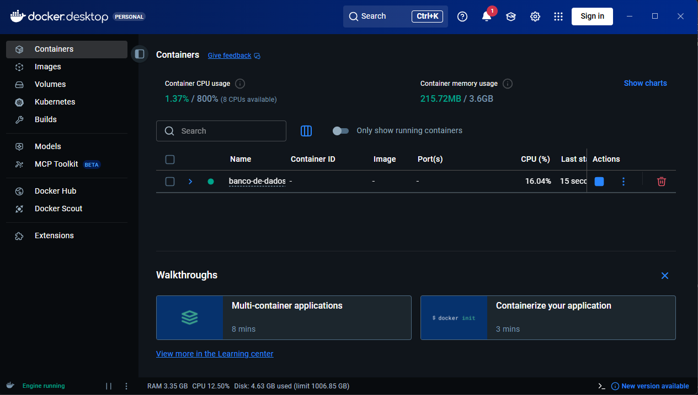

## Exercício 1 — SQL básico

Script: [exercicio-1.sql](exercicio-1/exercicio-1.sql)

**Criação das tabelas e inserção de dados**

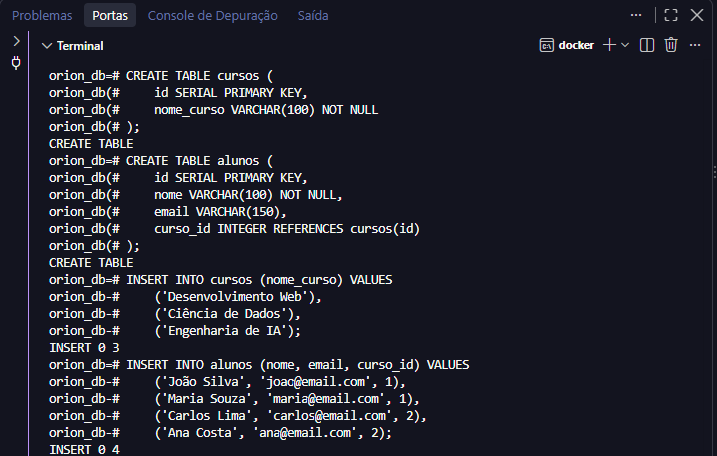

**SELECT * FROM alunos**

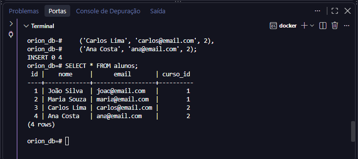

**Teste da chave estrangeira (erro esperado)**

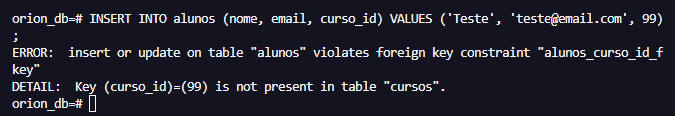

## Exercício 2 — JOINs e filtros

Script: [exercicio-2.sql](exercicio-2/exercicio-2.sql)

**INNER JOIN: nome do aluno e nome do curso**

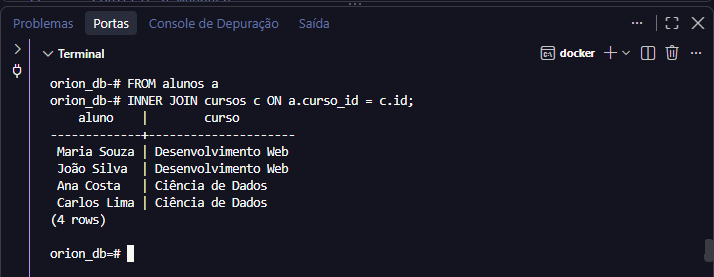

**JOIN + WHERE: alunos do curso "Desenvolvimento Web"**

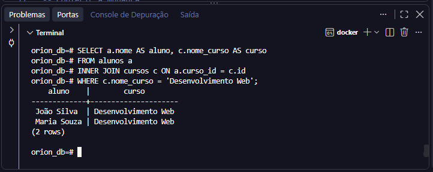

## Exercício 3 — MongoDB (CRUD básico)

Script: [exercicio-3.js](exercicio-3/exercicio-3.js)

**Criação da coleção `posts` e inserção dos dois documentos**

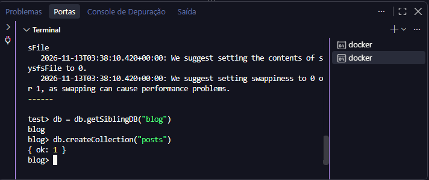

**find(): o segundo documento tem o campo `tags` e o primeiro não (schema flexível)**

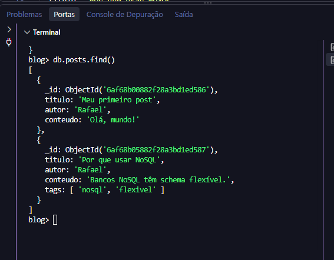

## Exercício 4 — MongoDB (consultas avançadas)

Script: [exercicio-4.js](exercicio-4/exercicio-4.js)

**updateOne(): adicionando `comentarios` (array de documentos)**

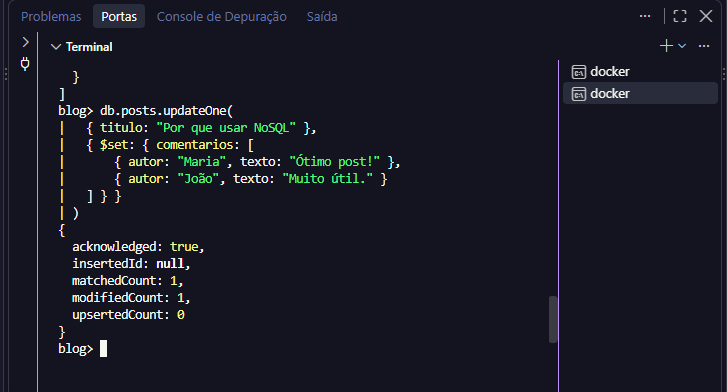

**find() com filtro dentro de array: posts com a tag "nosql"**

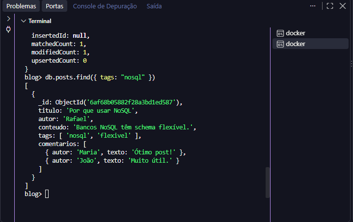

**find() por autor específico**


**Bônus: find() em documento aninhado (comentários da Maria)**

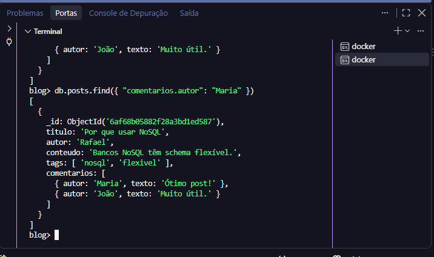